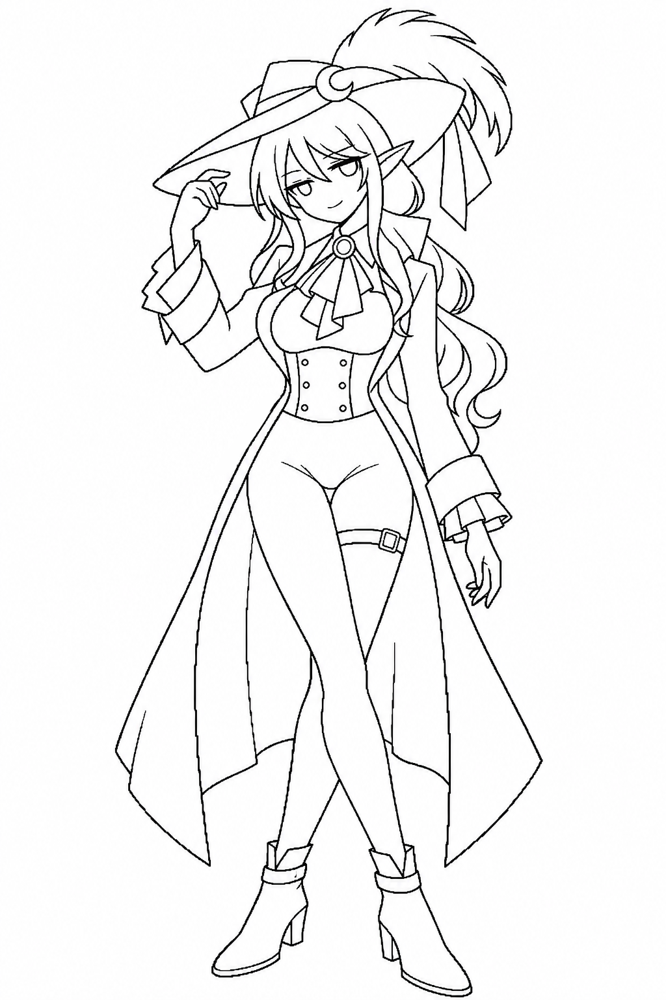
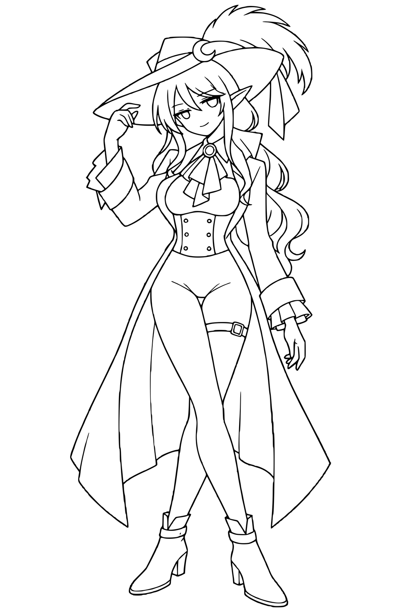

# ComfyUI-potrace_Line

[English](README_EN.md)

## 処理例：ビフォー・アフター

ご提供の `新規キャンバス6.png` と、ComfyUI で処理した `potrace_line_art_white_00010_.png` をリネームして同梱しました。アフターは `transparent_background=false` の白背景出力で、入力と同じ 1024×1536 ピクセルです。

| 入力画像 | 処理後（白背景プレビュー） |
| :---: | :---: |
|  |  |

顔まわりの同じ 300×300 ピクセルを切り抜き、線の違いが見えるように 3 倍に拡大しました。

| 処理前の拡大 | 処理後の拡大 |
| :---: | :---: |
|  |  |

白黒線画を [Potrace](https://potrace.sourceforge.net/) でなぞり直し、曲線をアンチエイリアス付きの画像として出力する ComfyUI カスタムノードです。標準設定では背景が透過になり、入力と同じ縦横サイズで出力します。画像のバッチ入力にも対応します。

## インストール

1. このフォルダを `ComfyUI/custom_nodes/ComfyUI-potrace_Line` に置きます。
2. **ComfyUI が使用する Python 環境で**依存ライブラリをインストールします。

   Windows で `C:\ComfyUI\.venv` を使っている場合:

   ```powershell
   C:\ComfyUI\.venv\Scripts\python.exe -m pip install -r C:\ComfyUI\custom_nodes\ComfyUI-potrace_Line\requirements.txt
   ```

   それ以外の環境:

   ```bash
   python -m pip install -r ComfyUI/custom_nodes/ComfyUI-potrace_Line/requirements.txt
   ```

3. ComfyUI を再起動します。

`requirements.txt` は既存の純 Python ライブラリ [`potracer`](https://pypi.org/project/potracer/) と曲線描画ライブラリ [`aggdraw`](https://pypi.org/project/aggdraw/) をインストールします。これらの実装はこのリポジトリに同梱していません。`pypotrace` ではなく `potracer` が必要です。
`IMPORT FAILED` と表示される場合は、ComfyUI を起動する Python に両方が入っているか確認してください。

## 使い方

`Load Image` → `Potrace Line Art / 線画を整える` → `Save Image` の順につなぎます。黒線・白背景の画像を入力してください。標準出力は黒線だけの RGBA 画像で、`Save Image` が透過PNGとして保存します。`transparent_background` を無効にすると RGB の白背景画像になります。グレーやカラーの入力は Pillow の輝度変換で二値化します。

| 入力 | 説明 |
| --- | --- |
| `threshold` | これより暗い画素を線とみなします。標準値は `0.70`。薄い線が消える場合は上げます。 |
| `despeckle` | 小さな点を除去する Potrace の面積しきい値。細部が消える場合は下げます。 |
| `smoothness` | Potrace の曲線化の強さ。`0` は角を残し、値を上げると滑らかになります。 |
| `antialias` | 曲線を描画する内部倍率。標準値は `3`。出力サイズとは別です。 |
| `pre_blur` | メディアン処理後、二値化前のガウスぼかし半径。標準では無効です。 |
| `median_filter` | 3×3 メディアンフィルターで細かなノイズを抑えます。標準では無効です。細線が消える場合は無効のままにしてください。 |
| `output_scale` | 出力の縦横倍率。標準値 `1` は入力と同じサイズ。`2` なら 1024×1536 入力から 2048×3072 を出力します。 |
| `transparent_background` | `true` で白背景を透明にし、線の濃さをアルファに変換します。標準は `true`。 |

標準設定の `threshold=0.70`、`median_filter=false` は、濃い線と細い線のある画像を比較して選びました。細線が消える場合は `threshold` を上げるか、`despeckle` を下げてください。

サンプル: [透過背景（標準）](examples/potrace_line_art.json) / [白背景](examples/potrace_line_art_white.json)。付属の [入力画像](examples/example_lineart.png) を `ComfyUI/input/` にコピーしてからワークフローを読み込むか、`Load Image` で手持ちの線画を選んでください。[白背景の出力例](examples/example_lineart_processed_white.png) は後者のワークフローの設定です。

Potrace は二値化後の形をなぞります。低解像度で潰れた細部や、途切れた線を推測して復元するものではありません。純 Python 実装のため、大きな画像や複雑な線画は処理に時間がかかります。2倍出力は元画像の4倍の画素数を使います。

## ライセンス

このノードは [GNU GPL-2.0-or-later](LICENSE) です。依存する `potracer` も GPL-2.0-or-later です。配布時はそれぞれのライセンス条件を守ってください。
